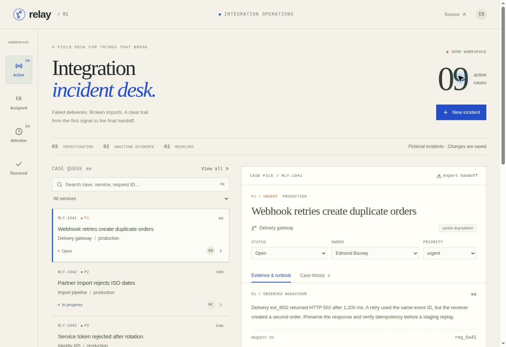
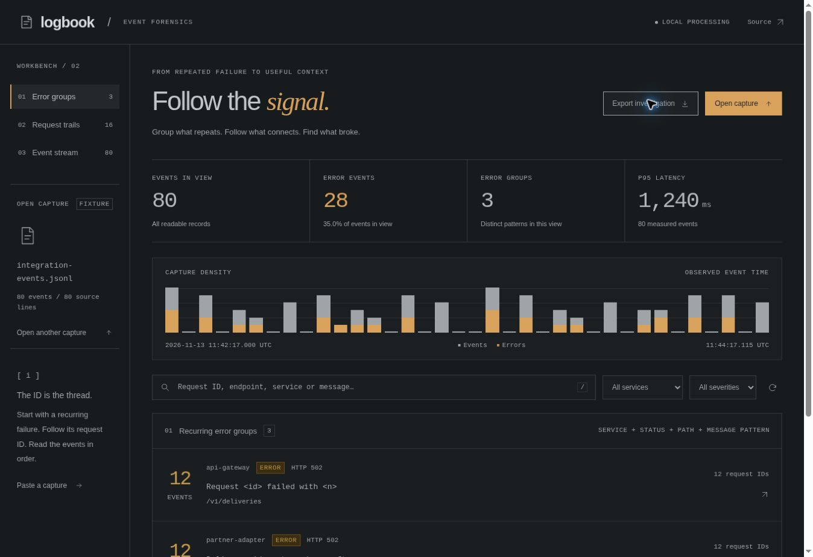

# Edmond Bassey

Freelance backend engineer based in Montréal. I build APIs and tools for tracking down failures. I am open to remote backend, QA and technical support work.

## Selected work

### [Relay — integration incident desk](projects/relay)

A case file for failed webhook deliveries, rejected imports, access failures and slow API requests. Each incident type has its own runbook. Evidence, saved checks and field notes stay together in a downloadable investigation handoff.

- TypeScript, React, REST API and persistent SQLite / Cloudflare D1 storage.
- Version checks prevent an older tab from overwriting a newer property change.
- Transactional audit writes keep the case history consistent with saved changes.
- Separate demo workspaces, validated runbook keys and bounded inputs.
- 26 SQL and request tests, including cross-workspace access, stale writes and rollback.

[Source and setup](projects/relay) · [Engineering notes](projects/relay/docs/engineering-notes.md) · [API reference](projects/relay/docs/api.md)

### [Logbook — event forensics](projects/logbook)

A local debugging workbench that groups repeated errors, follows one request across services and keeps the original JSON available. Its fictional capture follows the same duplicate-order scenario as Relay, including request `req_6a41`.

- Three views: Error groups, Request trails and Event stream.
- Grouping keeps service, severity and HTTP status separate, with documented normalization rules.
- Request timelines show recorded chronology and observed span, rather than inferred causal traces.
- Local JSONL imports, partial-import notes, filters, raw event inspection and investigation exports.
- 24 tests covering parsing, measurements, grouping boundaries, request ordering and exports.

[Source and setup](projects/logbook) · [Engineering notes](projects/logbook/docs/engineering-notes.md)

### [Portfolio — selected work](projects/portfolio)

A responsive site presenting the two tools through the problems they solve, with actual app screenshots, source links and notes on implementation decisions. Built with HTML and CSS, without runtime dependencies.

[Portfolio preview](https://edmond-bassey-works.regal-pixie-9265.chatgpt.site) · [Relay preview](https://edmond-relay-support.regal-pixie-9265.chatgpt.site) · [Logbook preview](https://edmond-logbook.regal-pixie-9265.chatgpt.site)

The hosted previews currently require owner access. Source code, screenshots and local setup instructions are public here. All application fixtures are fictional.

## Validation

[Portfolio checks](https://github.com/edmondbassey/First-repository/actions/workflows/portfolio.yml) runs Relay's type checks, SQL tests and build, Logbook's tests and build, and the portfolio build on project changes.

## Earlier coursework

- [Simple interest calculator](https://github.com/edmondbassey/Final) — browser app with validation and automated calculation tests.
- [Movie review database](https://github.com/edmondbassey/qkfls-Movie-Reviews-Database) — Node.js/Express coursework with Cloudant and Watson Natural Language Understanding.
- [Text and URL analysis](https://github.com/edmondbassey/cazgi-IBM-Watson-NLU-Project) — React/Express coursework using Watson.

Coursework retains its original attribution. Its READMEs describe the implemented and unfinished parts.

## Client work

Freelance client projects remain private under client agreements.

## Repository history

The original `firstpython.py` and `testchild.py` files are early Python and Git exercises. New applications live under `projects/`.
