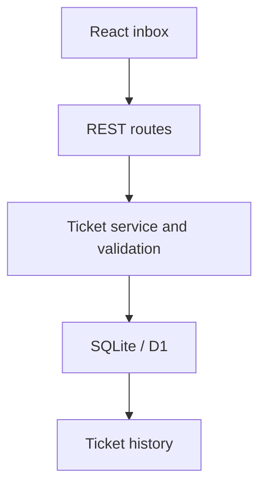

# Relay: architecture and walkthrough

## Follow one request

1. `app/page.tsx` sends a JSON request to the ticket route.
2. `lib/http.ts` resolves the session and workspace. `lib/request.ts` rejects cross-origin browser writes, wrong media types and oversized bodies.
3. `lib/domain.ts` validates input and status transitions.
4. `lib/service.ts` executes parameterized SQL against the workspace.
5. The route returns JSON. The interface refreshes the inbox and displays the saved record.

## Why transactions and versions both matter

A transaction keeps the ticket update and audit event together. It does not, by itself, stop an older browser tab from overwriting a newer value.

Each ticket has a version. Updates include the version they read; the SQL update only succeeds if that version still matches. A unique operation ID is written with the update. The audit insert checks that operation ID in the same transaction. A failed conditional update therefore cannot add a misleading event.

The integration test simulates a second write after the service reads the ticket and before its update executes. The original update returns 409, the new state remains intact and no extra event appears.

## Where isolation comes from

The browser receives an opaque UUID in an HttpOnly, SameSite cookie. Tickets and events belong to that workspace, and each query scopes its lookup by workspace ID. The test suite tries another workspace's ticket ID for reads, edits and notes.

This provides separation for a demo, not a substitute for account authentication or authorization in a production help desk.

## Data model

- Workspaces identify isolated demo sessions.
- Tickets hold the customer issue, assignee, status, target time and version.
- Ticket events record creation, property updates and internal notes.

The Drizzle schema generates the checked-in SQL migration. Request handlers never create or alter tables. Sample data is inserted when a new workspace starts.

## Walkthrough exercises

- Trace a new ticket from the form to the SQL insert and its returned JSON.
- Open the same ticket in two tabs, save one change, then attempt a different change in the older tab.
- Find the SQL condition that makes a ticket from another workspace inaccessible.
- Change a status-transition rule and update the corresponding test.
- Explain the difference between an internal note and an outbound customer reply.
- Compare the local SQLite test adapter with the hosted D1 binding.

## Next development work

Add account membership and roles before supporting real customer data. Move search and pagination to the API if workspaces grow beyond the demo limit. Add browser regression tests to cover the interface alongside the existing service and request tests.
